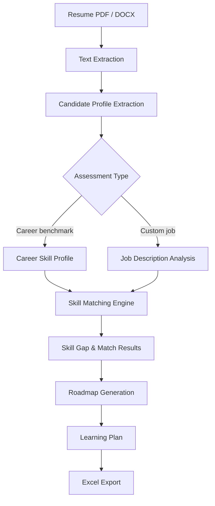

<!--
  SkillBridge README
  Keep badges and feature claims aligned with the implementation.
-->

<div align="center">

# 🌉 SkillBridge

### Turn your skills into a career direction.

**An AI-powered career intelligence platform for resume analysis, semantic skill-gap assessment, and personalized learning roadmaps.**

<p>
  <a href="https://github.com/Sujalproject/SkillBridge"></a>
  
  
  
  
</p>

<p>
  <a href="#-what-skillbridge-does">What it does</a> ·
  <a href="#-how-it-works">How it works</a> ·
  <a href="#-getting-started">Get started</a> ·
  <a href="#-api-reference">API</a>
</p>

</div>

---

## ✨ What SkillBridge does

SkillBridge helps students and job seekers understand how their current skills align with a target career or a specific job description — and what they can work on next.

| Capability | What it provides |
|---|---|
| 📄 **Resume intelligence** | Extracts structured candidate information from PDF and DOCX resumes. |
| 🎯 **Career benchmarking** | Compares candidate skills against locally maintained career skill profiles. |
| 🧠 **Semantic skill matching** | Looks beyond exact keyword matches to evaluate whether resume evidence demonstrates a required competency. |
| 🧩 **Skill-gap analysis** | Separates demonstrated skills from skills that still need evidence or development. |
| 📚 **Learning roadmaps** | Creates prioritized learning plans with topics, milestones, projects, resources, and estimated effort. |
| 📊 **Roadmap export** | Exports a generated roadmap to an Excel workbook. |

## 🧭 How it works

The analysis flow combines deterministic matching with LLM-assisted semantic evaluation. Roadmap generation is exposed as a separate workflow.



### Semantic matching pipeline

1. **Normalize** skill names and known aliases.
2. **Match deterministically** where exact or normalized matches are sufficient.
3. **Evaluate semantic evidence** with the LLM for candidate skills that did not match directly.
4. **Preserve display names** so results remain readable and traceable to the source terminology.

Semantic evaluation distinguishes between an exact match, strong evidence, related-but-insufficient evidence, and no evidence. A related term is not automatically treated as proof of proficiency.

## 🏗️ Architecture & technology

| Layer | Technology | Responsibility |
|---|---|---|
| API | **FastAPI** | HTTP endpoints, request validation, file uploads |
| Workflow orchestration | **LangGraph** | Structured career-analysis workflow |
| LLM inference | **Groq** | Candidate/JD extraction and semantic skill evaluation |
| Validation | **Pydantic** | Typed schemas and structured data |
| Resume parsing | **PyMuPDF**, **python-docx** | PDF and DOCX text extraction |
| Resource discovery | **Tavily** (optional) | Learning-resource search for roadmaps |
| Spreadsheet export | **openpyxl** | Excel roadmap generation |
| Frontend | **HTML, CSS, JavaScript** | Browser-based user interface |
| Testing & evaluation | **pytest**, custom evaluation framework | API tests and skill-matching quality checks |

### System design notes

- Career skill benchmarks are maintained in `data/career_skills.json`.
- Users can assess against a predefined career profile or provide a custom job description.
- Custom job descriptions are analyzed for role context, seniority, and mandatory/preferred skills.
- When both mandatory and preferred groups are present, the custom-JD score weights them at **70%** and **30%**, respectively. If only one group is present, that group receives the full weight.
- The current proficiency evidence assessment uses rule-based evidence tiers, including professional, internship, project, academic, mentioned, and insufficient evidence.
- Roadmap generation is a separate API workflow rather than a node in the main career-analysis graph.

## 🖥️ Project structure

```text
SkillBridge/
├── backend/
│   ├── core/           # Configuration and shared application settings
│   ├── graphs/         # LangGraph workflows
│   ├── routes/         # FastAPI route handlers
│   ├── schemas/        # Pydantic request/response schemas
│   ├── services/       # Resume, matching, career and roadmap logic
│   ├── utils/          # Shared utilities
│   └── main.py         # FastAPI application entry point
├── data/
│   └── career_skills.json
├── evaluation/
│   ├── dataset/        # Evaluation cases
│   ├── results/        # Evaluation outputs
│   ├── evaluator.py
│   ├── metrics.py
│   └── run.py
├── frontend/
│   ├── images/
│   ├── index.html
│   ├── styles.css
│   └── app.js
├── tests/
├── requirements.txt
└── README.md
```

## 🚀 Getting started

### 1. Clone the repository

```bash
git clone https://github.com/Sujalproject/SkillBridge.git
cd SkillBridge
```

### 2. Create and activate a virtual environment

**Windows (PowerShell)**

```powershell
python -m venv .venv
.venv\Scripts\Activate.ps1
```

**macOS / Linux**

```bash
python -m venv .venv
source .venv/bin/activate
```

### 3. Install dependencies

```bash
pip install -r requirements.txt
```

### 4. Configure environment variables

Create a `.env` file in the project root:

```env
GROQ_API_KEY=your_groq_api_key
GROQ_MODEL=openai/gpt-oss-20b

# Optional: enables learning-resource search for roadmaps
TAVILY_API_KEY=your_tavily_api_key
```

Keep API keys private. Do not commit your `.env` file.

### 5. Start the backend

From the project root:

```bash
uvicorn backend.main:app --reload
```

Once the server is running, open:

- API documentation: [http://127.0.0.1:8000/docs](http://127.0.0.1:8000/docs)
- Alternative API docs: [http://127.0.0.1:8000/redoc](http://127.0.0.1:8000/redoc)

Open `frontend/index.html` in your browser to use the frontend. If your local setup uses a separate static server, serve the `frontend` directory with that server.

## 🔌 API reference

The main application exposes the following documented workflows:

| Method | Endpoint | Purpose |
|---|---|---|
| `GET` | `/careers` | Retrieve available career profiles |
| `GET` | `/careers/{career_name}/skills` | Retrieve the skill profile for a career |
| `POST` | `/career-agent/analyze` | Analyze a resume against a career profile or custom job description |
| `POST` | `/roadmap/generate` | Generate a prioritized learning roadmap |
| `POST` | `/roadmap/export` | Export a roadmap as an Excel workbook |

Interactive request schemas and response details are available in the FastAPI Swagger UI at `/docs`.

## 🧪 Evaluation & testing

SkillBridge includes a custom evaluation framework and a pytest suite.

The evaluation code covers areas such as:

- Skill normalization and matching quality
- Precision, recall, and F1
- False-positive tracking
- Match-score properties
- Proficiency evidence classification

Run the test suite from the repository root:

```bash
pytest
```

Run the evaluation pipeline:

```bash
python -m evaluation.run
```

Check the evaluation module for the available dataset and output configuration before comparing runs.

## ⚖️ Design considerations & current limitations

- **Evidence matters:** a related skill name is not enough to establish that a candidate has demonstrated a competency.
- **Benchmarks are editable data:** predefined career profiles are maintained locally and should be reviewed for the roles and market being assessed.
- **LLM output needs evaluation:** semantic judgments can vary with model behavior and resume quality.
- **Document support:** the current parser accepts PDF and DOCX files, with a configured upload-size limit of 5 MB. Scanned-document OCR is not currently included.
- **Roadmap resources:** Tavily is optional; resource discovery depends on its API key being configured.
- **Persistence and accounts:** the current project does not provide a database-backed candidate profile store or user authentication.

## 🛣️ Potential next steps

- Add OCR support for scanned resumes.
- Expand and version career skill benchmarks.
- Add human review for ambiguous skill matches.
- Introduce a database-backed profile and assessment history.
- Add broader LLM evaluation and regression datasets.
- Track roadmap progress and completed learning milestones.

## 🤝 Contributing

Contributions, bug reports, and suggestions are welcome.

1. Fork the repository.
2. Create a feature branch: `git checkout -b feature/your-feature`.
3. Make focused changes and add or update tests.
4. Run `pytest`.
5. Open a pull request with a clear description of the change.

## 🔐 Security

- Store secrets in environment variables.
- Never commit API keys, credentials, or personal resume data.
- Treat uploaded resumes and generated candidate profiles as sensitive information.
- Validate file types and sizes when changing upload behavior.

---

<div align="center">

**SkillBridge — understand your skills, identify your gaps, and plan your next step.**

<sub>Built with Python · FastAPI · LangGraph · Groq</sub>

</div>
