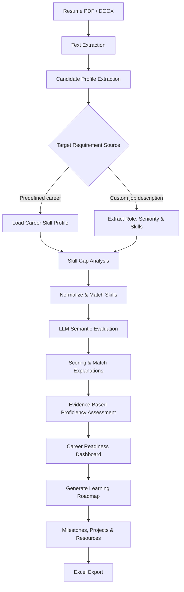
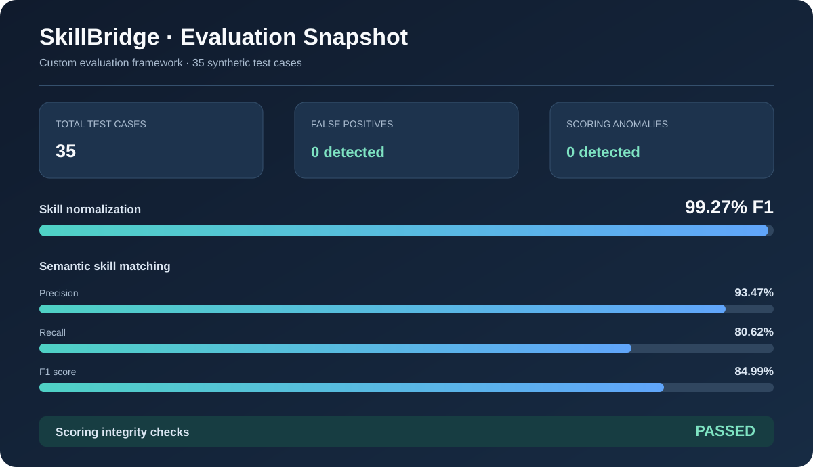

<!--
  SkillBridge README
  Keep feature claims, API details, and evaluation figures aligned with main.
-->

<div align="center">

# 🌉 SkillBridge

### Bridge the gap between your resume and your target role.

**An AI-powered career readiness platform that analyzes resumes, evaluates skill gaps against career benchmarks or custom job descriptions, verifies supporting evidence, and builds personalized learning roadmaps.**

<p>
  <a href="https://github.com/Sujalproject/SkillBridge"></a>
  
  
  
  
  
</p>

<p>
  <a href="#-what-skillbridge-does">Features</a> ·
  <a href="#-how-it-works">Workflow</a> ·
  <a href="#-architecture--technology">Architecture</a> ·
  <a href="#-getting-started">Get started</a> ·
  <a href="#-evaluation--quality">Evaluation</a>
</p>

</div>

---

## ✨ What SkillBridge does

SkillBridge helps students and job seekers understand how their demonstrated skills align with a target role — and gives them a practical path to close the gaps.

| Capability | What it provides |
|---|---|
| 📄 **Resume intelligence** | Extracts candidate details, skills, education, projects, and experience from PDF and DOCX resumes. |
| 🎯 **Career benchmarking** | Compares candidate skills against locally maintained career profiles. |
| 📝 **Custom job-description analysis** | Extracts role context, seniority, mandatory skills, and preferred skills from a pasted job description. |
| 🧠 **Semantic skill matching** | Combines normalized exact matching, competency relationships, and LLM-assisted evaluation rather than relying only on keyword overlap. |
| 🔎 **Evidence inspection** | Shows the resume evidence behind matched skills and classifies the evidence by source. |
| 🧩 **Skill-gap diagnosis** | Separates matched and missing requirements, explains matches, and highlights high-impact gaps. |
| 🗺️ **Personalized learning roadmap** | Generates sequential milestones, topics, hands-on projects, estimated effort, and learning resources for priority gaps. |
| 📊 **Progress tracking & export** | Tracks completed roadmap topics in the browser and exports the roadmap to a styled Excel workbook. |

## 🧭 How it works

The main career-analysis workflow is orchestrated with LangGraph. It branches between a predefined career benchmark and a custom job description, then converges on skill-gap analysis.



### Skill-matching pipeline

1. **Normalize skill terminology** using a canonical alias map for common acronyms, variants, and equivalent labels.
2. **Match deterministically** using normalized exact matches, disjunctive requirements, and selected competency/root relationships.
3. **Evaluate remaining requirements semantically** with Groq in small batches. Only exact matches and strong evidence are accepted as semantic matches.
4. **Recover partial model output** where possible if a response is truncated, instead of discarding every complete evaluation in that batch.
5. **Preserve source-facing names** in the result so matched and missing skills remain readable against the original career profile or job description.
6. **Calculate a weighted readiness score** using the active scoring model and return match explanations and priority gaps.

The semantic evaluator currently uses batches of 8 required skills, a 450-token response limit, and retry delays parsed from Groq rate-limit messages. A deterministic matching path is also available to the evaluation framework for scoring-property checks.

### Evidence-based proficiency

For matched skills, SkillBridge inspects resume context and assigns an evidence tier:

| Evidence tier | Meaning |
|---|---|
| **Professional** | Skill appears in the candidate's employment experience. |
| **Internship** | Skill appears in an internship context. |
| **Project** | Skill is supported by a project or implementation statement. |
| **Academic** | Skill appears in education or coursework context. |
| **Mentioned** | Skill appears in the skills inventory without supporting narrative. |
| **Insufficient evidence** | The resume does not provide direct contextual evidence. |

The assessment also returns a qualitative confidence label and a short supporting-evidence excerpt. It does not invent years of experience or numerical proficiency ratings.

## 🖥️ Product experience

The browser interface is served by the FastAPI application and includes:

- A **standard-role / custom-JD switcher** with dynamically loaded career options and quick-select role chips.
- A drag-and-drop **PDF/DOCX resume upload** area with file validation and an analysis progress stepper.
- A **career-readiness dashboard** with match percentage, matched/missing counts, and a side-by-side candidate-versus-benchmark skill view.
- Searchable and filterable skill results, plus an **evidence inspector** for matched skills.
- Candidate profile and experience timeline sections.
- A roadmap workspace with milestone cards, difficulty and time estimates, topic checkboxes, project suggestions, and resource links.
- **Dark and light themes**, with the selected theme remembered in browser storage.
- Session restoration for analysis and roadmap results during a normal page refresh. The frontend uses the API's server boot ID to detect a backend restart and clear stale session results.
- Per-roadmap topic completion saved in browser local storage.

## 🏗️ Architecture & technology

| Layer | Technology | Responsibility |
|---|---|---|
| API | **FastAPI** | HTTP endpoints, request validation, uploads, and static frontend serving |
| Workflow orchestration | **LangGraph** | Resume-to-career-analysis graph and conditional requirement-source routing |
| LLM inference | **Groq** | Resume/JD extraction, semantic skill evaluation, and roadmap generation |
| Validation & schemas | **Pydantic** | Typed request and response models |
| Resume parsing | **PyMuPDF**, **python-docx** | PDF and DOCX text extraction |
| Resource discovery | **Tavily** (optional) | Finds learning resources for roadmap milestones |
| Spreadsheet export | **openpyxl** | Generates styled Excel roadmap workbooks |
| Frontend | **HTML, CSS, JavaScript** | Responsive dashboard and interactive roadmap experience |
| Evaluation | **pytest**, custom evaluation framework | Regression cases, matching metrics, and scoring-property audits |

### System design notes

- Predefined career benchmarks are maintained in `data/career_skills.json`.
- A user can select a predefined career or submit a custom job description.
- Custom job-description input is capped at **10,000 characters**. The extraction workflow identifies job context and separates mandatory and preferred requirements when present.
- When both mandatory and preferred skill groups are available, custom-JD scoring weights them at **70%** and **30%**. If only one group is available, that group receives the full weight.
- The semantic matcher uses normalized aliases and deterministic competency relationships before calling the LLM for remaining requirements.
- Roadmap generation is a separate API workflow. It plans up to **8 priority missing skills** per roadmap and can use Tavily to discover resources; resource search is optional.
- The backend exposes a `/health` endpoint with a unique boot ID. The frontend uses it to distinguish a normal page refresh from a backend restart.

## 🗂️ Project structure

```text
SkillBridge/
├── backend/
│   ├── core/              # Configuration and skill-importance logic
│   ├── graphs/            # LangGraph state, nodes, and career workflow
│   ├── routes/             # FastAPI route handlers
│   ├── schemas/            # Pydantic request/response schemas
│   ├── services/           # Resume, JD, matching, proficiency, and roadmap logic
│   ├── utils/              # Resume parsing and shared utilities
│   └── main.py             # FastAPI application and frontend mount
├── data/
│   └── career_skills.json  # Predefined career skill benchmarks
├── evaluation/
│   ├── dataset/            # Synthetic evaluation cases
│   ├── results/            # Evaluation reports
│   ├── evaluator.py        # Evaluation orchestration
│   ├── metrics.py          # Normalization and matching metrics
│   └── run.py              # CLI evaluation runner
├── frontend/
│   ├── images/
│   ├── index.html
│   ├── styles.css
│   └── app.js
├── tests/                  # Automated tests
├── requirements.txt
└── README.md
```

## 🚀 Getting started

### 1. Clone the repository

```bash
git clone https://github.com/Sujalproject/SkillBridge.git
cd SkillBridge
```

### 2. Create and activate a virtual environment

**Windows (PowerShell)**

```powershell
python -m venv .venv
.venv\Scripts\Activate.ps1
```

**macOS / Linux**

```bash
python -m venv .venv
source .venv/bin/activate
```

### 3. Install dependencies

```bash
pip install -r requirements.txt
```

### 4. Configure environment variables

Create a `.env` file in the project root:

```env
GROQ_API_KEY=your_groq_api_key
GROQ_MODEL=openai/gpt-oss-20b

# Optional: enables learning-resource search for roadmaps
TAVILY_API_KEY=your_tavily_api_key
```

A Groq API key is required for LLM-powered analysis and roadmap generation. Tavily is optional; without it, the roadmap generator can still create a learning plan but will not retrieve live resource links.

Keep API keys private. Do not commit your `.env` file.

### 5. Run SkillBridge

From the repository root:

```bash
uvicorn backend.main:app --reload
```

Open the application and API documentation:

| URL | Purpose |
|---|---|
| [http://127.0.0.1:8000/](http://127.0.0.1:8000/) | SkillBridge web application |
| [http://127.0.0.1:8000/docs](http://127.0.0.1:8000/docs) | Interactive Swagger API documentation |
| [http://127.0.0.1:8000/redoc](http://127.0.0.1:8000/redoc) | ReDoc API documentation |
| [http://127.0.0.1:8000/health](http://127.0.0.1:8000/health) | Backend health and boot ID |

## 🔌 API reference

| Method | Endpoint | Purpose |
|---|---|---|
| `GET` | `/health` | Check backend status and retrieve the current server boot ID |
| `GET` | `/careers` | Retrieve available predefined career profiles |
| `GET` | `/careers/{career_name}/skills` | Retrieve the skill benchmark for a career |
| `POST` | `/resume/analyze` | Parse and analyze an uploaded resume |
| `POST` | `/skills/analyze` | Analyze supplied candidate skills against a predefined career profile |
| `POST` | `/career-agent/analyze` | Run the full resume analysis against a career profile or custom job description |
| `POST` | `/roadmap/generate` | Generate a personalized roadmap for missing skills |
| `POST` | `/roadmap/export` | Export a roadmap as a styled Excel workbook |

See the Swagger UI at `/docs` for request schemas, parameters, and response models.

## 🧪 Evaluation & quality

SkillBridge includes a custom evaluation framework with **35 synthetic evaluation cases**. It measures skill normalization, semantic matching, false-positive guardrails, scoring integrity, and proficiency-evidence classification.

### Evaluation dashboard

<p align="center">
  
</p>

### Latest committed evaluation snapshot

<sub>Report: `evaluation/results/evaluation_report.json` · 35 synthetic cases</sub>

| Metric | Result |
|---|---:|
| **Normalization — macro precision** | **99.68%** |
| **Normalization — macro recall** | **99.68%** |
| **Normalization — macro F1** | **99.68%** |
| **Skill matching — macro precision** | **98.18%** |
| **Skill matching — macro recall** | **95.44%** |
| **Skill matching — macro F1** | **96.64%** |
| **Skill matching — micro precision** | **97.39%** |
| **Skill matching — micro recall** | **93.85%** |
| **Skill matching — micro F1** | **95.59%** |
| **Micro true positives** | **336** |
| **Micro false positives** | **9** |
| **Micro false negatives** | **22** |
| Targeted non-equivalent false-positive checks | **0 detected** |
| Scoring anomalies | **0** |
| Scoring-property audit | **Passed** |

### How to interpret these results

- **Macro metrics** calculate precision, recall, and F1 per case, then average across the 35 cases. Each case has equal weight.
- **Micro metrics** aggregate true positives, false positives, and false negatives across all evaluated skills before calculating the scores. Larger cases therefore contribute more.
- The **9 micro false positives** are matching-metric false positives across the full expected-versus-actual skill sets. The separate targeted non-equivalent check count is **0**; it tracks a narrower set of explicitly annotated related-but-not-equivalent skills. These are different checks and should not be conflated.
- Scoring audits check boundedness, monotonicity, neutrality to unrelated skills, duplicate resilience, and expected-score calibration where a case defines a target.
- The proficiency distribution in this report is **18 Project Experience** and **17 Mentioned / Keyword Listing** classifications.

### What is evaluated?

- **Normalization:** canonicalization of extracted skill names, abbreviations, and known aliases.
- **Semantic matching:** macro and micro precision, recall, F1, plus targeted checks for related-but-not-equivalent skills.
- **Scoring integrity:** boundedness, monotonicity, neutrality to unrelated skills, duplicate resilience, and expected-score calibration.
- **Proficiency evidence:** classification of evidence found in resume text and structured candidate sections.

> **Evaluation note:** These figures come from the repository's synthetic test dataset. They are a repeatable development baseline, not a claim of production accuracy or validation against recruiter decisions. LLM-assisted semantic results can vary with model behavior, prompts, and dataset changes. The committed JSON report is the source of the displayed snapshot.

### Run tests and evaluation

From the repository root:

```bash
pytest
python -m evaluation.run
```

Optional detailed output:

```bash
python -m evaluation.run --verbose
python -m evaluation.run --output evaluation/results/evaluation_report.json
```

The evaluation runner writes the detailed JSON report to `evaluation/results/evaluation_report.json` by default.

## ⚖️ Design considerations & current limitations

- **Evidence is not the same as proficiency:** a skill appearing in a resume's skills list is classified differently from one supported by project or employment context.
- **Semantic matching is probabilistic:** LLM judgments may vary and should be reviewed for high-stakes hiring decisions.
- **Benchmarks are editable data:** predefined career profiles live in `data/career_skills.json` and should be maintained as role requirements evolve.
- **Document support:** PDF and DOCX files are accepted, with a maximum upload size of **5 MB**. Scanned PDFs that contain no readable text are not OCR-processed.
- **Roadmap scope:** each generated roadmap is limited to the top 8 missing skills to keep the plan focused and within model limits.
- **External resources:** live resource discovery depends on an optional Tavily API key and service availability.
- **Persistence:** analysis and roadmap restoration is browser-session based; completed roadmap topics and theme preference use browser local storage. There is no database-backed candidate history.
- **Authentication:** user accounts and authentication are not currently included.

## 🛣️ Potential next steps

- Add OCR support for scanned resumes.
- Expand and version career skill benchmarks.
- Add human review for ambiguous semantic matches and evidence classifications.
- Introduce database-backed candidate profiles and assessment history.
- Expand evaluation with larger, independently reviewed datasets and additional LLM-quality checks.
- Add roadmap progress analytics across sessions and devices.

## 🤝 Contributing

Contributions, bug reports, and suggestions are welcome.

1. Fork the repository.
2. Create a feature branch: `git checkout -b feature/your-feature`.
3. Make focused changes and add or update tests.
4. Run `pytest` and relevant evaluation checks.
5. Open a pull request with a clear description of the change.

## 🔐 Security

- Store secrets in environment variables.
- Never commit API keys, credentials, or personal resume data.
- Treat uploaded resumes and generated candidate profiles as sensitive information.
- Validate file types and sizes when changing upload behavior.

---

<div align="center">

**SkillBridge — understand your skills, verify your evidence, and build your next career step.**

<sub>Built with Python · FastAPI · LangGraph · Groq</sub>

</div>
