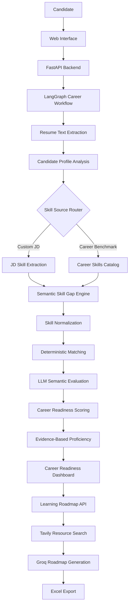
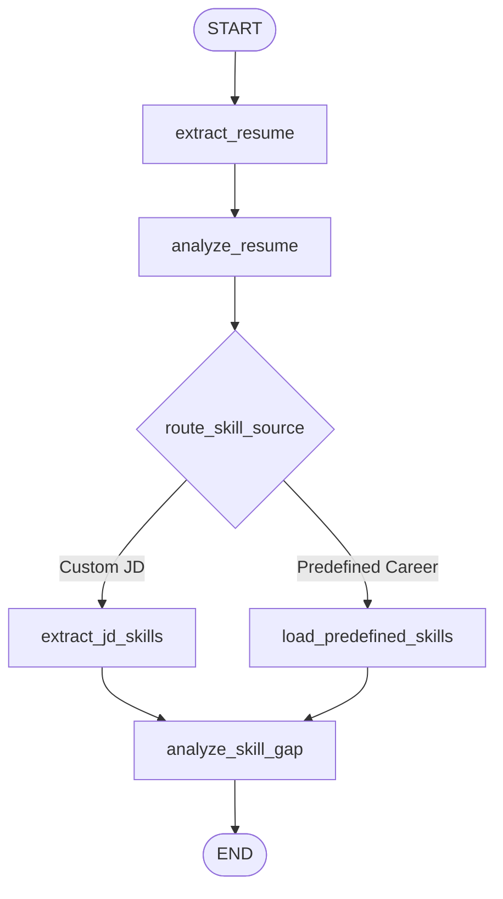

# SkillBridge — AI-Powered Career Intelligence Platform

<p align="center">
  <strong>Analyze. Identify. Bridge the Gap.</strong>
</p>

<p align="center">
  An agentic AI platform that transforms resumes into actionable career intelligence through semantic skill matching, evidence-based proficiency assessment, and personalized learning roadmaps.
</p>

<p align="center">
  <a href="https://github.com/Sujalproject/SkillBridge">GitHub Repository</a> ·
  <a href="#architecture">Architecture</a> ·
  <a href="#getting-started">Getting Started</a> ·
  <a href="#api-reference">API Reference</a>
</p>

---

## Overview

**SkillBridge** is an AI-powered career intelligence platform designed to help students and job seekers understand their technical capabilities, evaluate their readiness for target roles, and identify the skills they need to develop.

Unlike traditional resume analyzers that primarily rely on keyword matching, SkillBridge uses a multi-stage semantic skill analysis engine combined with LLM-powered reasoning to evaluate technical competencies beyond exact skill-name matches.

The platform supports two career assessment approaches:

- **Career Benchmarking:** Evaluates a candidate against predefined technical skill requirements for a selected career.
- **Custom Job Description Analysis:** Extracts mandatory and preferred skills from a job description and evaluates the candidate against those specific requirements.

Based on the assessment, SkillBridge generates a structured career readiness analysis and personalized learning roadmap.

## Key Features

### 1. Intelligent Resume Analysis

- Supports PDF and DOCX resume uploads.
- Extracts document content using PyMuPDF and python-docx.
- Uses Groq-powered LLM inference to generate structured candidate profiles.
- Identifies technical skills, education, projects, and professional experience.
- Uses Pydantic models for structured data validation.

### 2. Dynamic Job Description Intelligence

Extracts technical requirements directly from user-provided job descriptions.

The JD extraction pipeline identifies:

- Job title and seniority level.
- Mandatory technical skills.
- Preferred technical skills.
- Role-specific requirements.
- Structured skill representations.

This enables SkillBridge to evaluate candidates against individual job requirements rather than relying exclusively on predefined career templates.

### 3. Multi-Stage Semantic Skill Matching

SkillBridge implements a four-stage skill matching pipeline.

| Stage | Technique | Purpose |
|---|---|---|
| 1 | Skill normalization | Resolves technical aliases and standard abbreviations |
| 2 | Deterministic matching | Identifies exact and normalized matches |
| 3 | LLM semantic evaluation | Evaluates competency relationships and transferable technical evidence |
| 4 | Result compilation | Preserves original skill names and generates match explanations |

The semantic evaluation distinguishes between:

- Exact Match
- Strong Evidence
- Related but Insufficient
- No Evidence

For example, Docker can provide evidence of containerization knowledge, while PostgreSQL can provide evidence of relational database knowledge.

The objective is to recognize meaningful competency relationships without treating every related technology as equivalent.

### 4. Weighted Career Readiness Scoring

SkillBridge supports different scoring strategies depending on the assessment context.

**Custom Job Description:**

When both mandatory and preferred skill groups are available:

- Mandatory skills: 70%
- Preferred skills: 30%

When only one category is available, the available category receives the full scoring weight.

**Predefined Career Benchmark:**

Uses role-specific skill importance tiers to give greater weight to critical competencies than secondary skills.

The system also generates:

- Matched skills.
- Missing skills.
- Match explanations.
- Scoring breakdown.
- High-impact skill gaps.

### 5. Evidence-Based Proficiency Assessment

SkillBridge evaluates the evidence associated with candidate skills rather than assigning arbitrary experience levels.

Current evidence categories include:

| Evidence Tier | Description |
|---|---|
| Professional | Skill appears in professional experience |
| Internship | Skill appears in internship context |
| Project | Skill appears in practical project evidence |
| Academic | Skill appears in educational context |
| Mentioned | Skill appears in the skills inventory |
| Insufficient Evidence | No supporting evidence identified |

Each assessment includes a qualitative confidence level and supporting evidence.

### 6. Personalized Learning Roadmap

SkillBridge transforms identified skill gaps into actionable learning milestones.

Roadmap generation considers:

- Target career.
- Missing technical skills.
- Existing candidate skills.
- Estimated learning hours.
- Difficulty levels.
- Topics to learn.
- Hands-on project suggestions.
- Learning resources.

Groq generates the structured learning plan, while Tavily searches for relevant learning resources.

The current implementation generates milestones for up to eight priority missing skills per roadmap request.

### 7. Learning Resource Discovery

Uses Tavily Search API to discover resources for missing competencies.

The resource discovery workflow:

1. Generates skill-specific search queries.
2. Retrieves relevant documentation and tutorials.
3. Collects resource titles and URLs.
4. Supplies the retrieved resources as context to the roadmap generation process.

### 8. Excel Roadmap Export

Generates downloadable Excel learning plans containing structured roadmap information.

The export functionality uses OpenPyXL and supports formatted workbook generation with resource hyperlinks.

### 9. AI Evaluation Framework

SkillBridge includes an automated evaluation framework for assessing important components of the career intelligence pipeline.

Current evaluation areas:

- Skill normalization.
- Semantic skill matching.
- Precision, recall, and F1 score.
- False-positive detection.
- Scoring calibration.
- Scoring property validation.
- Proficiency evidence assessment.

The evaluation suite uses a synthetic ground-truth dataset and offline automated tests.

---

## Architecture

SkillBridge uses a modular backend architecture with LangGraph orchestrating the primary career analysis workflow.

### High-Level Architecture



### LangGraph Workflow

The primary career analysis workflow is implemented using LangGraph's `StateGraph`.



The graph uses a shared `CareerState` to pass information between nodes.

The roadmap currently operates through a separate API workflow.

---

## Technology Stack

| Category | Technologies |
|---|---|
| Language | Python |
| Backend | FastAPI |
| AI Orchestration | LangGraph, LangChain |
| LLM Inference | Groq |
| Default Model | GPT-OSS 20B through Groq |
| Structured Validation | Pydantic |
| Document Processing | PyMuPDF, python-docx |
| Web Research | Tavily Search API |
| Excel Generation | OpenPyXL |
| Frontend | HTML5, CSS3, JavaScript |
| Evaluation | Pytest, Custom Evaluation Framework |

---

## Project Structure

```text
SkillBridge/
│
├── backend/
│   ├── core/
│   │   ├── config.py
│   │   └── skill_importance.py
│   │
│   ├── graphs/
│   │   ├── career_graph.py
│   │   ├── nodes.py
│   │   └── state.py
│   │
│   ├── routes/
│   │   ├── career.py
│   │   ├── career_agent.py
│   │   ├── resume.py
│   │   ├── skill_gap.py
│   │   └── roadmap.py
│   │
│   ├── schemas/
│   │
│   ├── services/
│   │   ├── career_service.py
│   │   ├── jd_service.py
│   │   ├── proficiency_service.py
│   │   ├── resume_service.py
│   │   ├── roadmap_service.py
│   │   └── semantic_skill_gap_service.py
│   │
│   ├── utils/
│   │   ├── resume_parser.py
│   │   └── excel_exporter.py
│   │
│   └── main.py
│
├── data/
│   └── career_skills.json
│
├── evaluation/
│   ├── dataset/
│   │   └── cases.json
│   ├── results/
│   ├── evaluator.py
│   ├── metrics.py
│   └── run.py
│
├── frontend/
│   ├── images/
│   ├── index.html
│   ├── styles.css
│   └── app.js
│
├── tests/
│   ├── conftest.py
│   ├── test_api.py
│   ├── test_evaluation_framework.py
│   ├── test_excel_exporter.py
│   ├── test_jd_pipeline.py
│   ├── test_resume_parser.py
│   └── test_roadmap_service.py
│
├── requirements.txt
└── README.md
```

---

## Getting Started

### Prerequisites

Make sure the following are installed:

- Python 3.10 or higher.
- Git.
- Groq API key.
- Tavily API key (optional, for external learning resource discovery).

### 1. Clone the Repository

```bash
git clone https://github.com/Sujalproject/SkillBridge.git

cd SkillBridge
```

### 2. Create a Virtual Environment

**Windows:**

```bash
python -m venv venv

venv\Scripts\activate
```

**Linux / macOS:**

```bash
python3 -m venv venv

source venv/bin/activate
```

### 3. Install Dependencies

```bash
python -m pip install --upgrade pip

pip install -r requirements.txt
```

### 4. Configure Environment Variables

Create a `.env` file in the project root directory.

```env
GROQ_API_KEY=your_groq_api_key
GROQ_MODEL=openai/gpt-oss-20b

TAVILY_API_KEY=your_tavily_api_key
```

**Configuration:**

| Variable | Required | Description |
|---|---|---|
| `GROQ_API_KEY` | Yes | Groq API authentication |
| `GROQ_MODEL` | No | Model identifier; defaults to `openai/gpt-oss-20b` |
| `TAVILY_API_KEY` | No | Enables external learning resource discovery |

Keep your `.env` file private. Never commit API credentials to GitHub.

### 5. Run the Application

Start the FastAPI development server:

```bash
uvicorn backend.main:app --reload
```

The application will be available at:

```text
http://127.0.0.1:8000
```

The frontend is served by FastAPI when the frontend directory is present.

### 6. Access API Documentation

FastAPI automatically generates interactive API documentation.

- Swagger UI: http://127.0.0.1:8000/docs
- ReDoc: http://127.0.0.1:8000/redoc
- Health Check: http://127.0.0.1:8000/health

---

## API Reference

The following endpoints are currently implemented.

| Method | Endpoint | Description |
|---|---|---|
| GET | `/health` | Backend health check |
| GET | `/careers` | Retrieve available career roles |
| GET | `/careers/{career_name}/skills` | Retrieve required skills for a role |
| POST | `/resume/analyze` | Analyze an uploaded resume |
| POST | `/skills/analyze` | Perform predefined career skill-gap analysis |
| POST | `/career-agent/analyze` | Execute the complete LangGraph career analysis workflow |
| POST | `/roadmap/generate` | Generate a personalized learning roadmap |
| POST | `/roadmap/export` | Export the learning roadmap to Excel |

### Example: Career Analysis

**Endpoint**

```http
POST /career-agent/analyze
```

**Content Type**

```text
multipart/form-data
```

**Parameters**

| Parameter | Type | Description |
|---|---|---|
| `file` | File | PDF or DOCX resume |
| `career` | String | Selected career benchmark |
| `job_description` | String | Optional custom job description |

Provide either a career selection or a sufficiently long custom job description.

### Example: Roadmap Generation

**Endpoint**

```http
POST /roadmap/generate
```

**Request Body**

```json
{
  "career": "AI Engineer",
  "missing_skills": [
    "Model Evaluation",
    "Vector Databases",
    "Docker"
  ],
  "student_skills": [
    "Python",
    "FastAPI",
    "LangChain",
    "Machine Learning"
  ]
}
```

**Response Structure**

```json
{
  "career": "AI Engineer",
  "total_estimated_weeks": 6,
  "milestones": [
    {
      "skill_name": "Model Evaluation",
      "week_label": "Week 1 - 2",
      "estimated_hours": 15,
      "difficulty": "Intermediate",
      "topics_to_learn": [
        "Evaluation metrics",
        "LLM evaluation"
      ],
      "completed_topics": [],
      "hands_on_project": "Build an LLM evaluation pipeline",
      "resources": []
    }
  ]
}
```

The response above illustrates the schema; actual milestones and resource values are generated dynamically.

---

## Evaluation Framework

SkillBridge includes a dedicated evaluation module to assess the reliability of its AI-powered components.

### Evaluation Metrics

| Metric | Purpose |
|---|---|
| Precision | Measures correctness of identified skill matches |
| Recall | Measures coverage of expected skill matches |
| F1 Score | Measures the balance between precision and recall |
| False Positive Count | Identifies incorrect competency matches |
| Scoring Drift | Measures deviation from expected career readiness scores |
| Scoring Invariants | Tests scoring properties such as boundedness and deduplication |

### Scoring Property Tests

The evaluation engine also checks:

1. **Boundedness:** Career readiness scores remain between 0 and 100.
2. **Monotonicity:** Adding a genuinely missing required skill should not reduce the score.
3. **Neutrality:** Adding unrelated skills should not artificially improve the score.
4. **Deduplication:** Repeated candidate skills should not inflate the score.
5. **Calibration:** Calculated scores should align with expected benchmark scores.

### Run Evaluation

Execute the evaluation suite:

```bash
python -m evaluation.run
```

Generate detailed per-case output:

```bash
python -m evaluation.run --verbose
```

Save the evaluation report:

```bash
python -m evaluation.run --output evaluation/results/report.json
```

### Run Automated Tests

```bash
pytest -v
```

The evaluation framework uses synthetic ground-truth cases and is designed to run offline. The full application still requires API credentials for its LLM-powered functionality.

---

## Design Considerations

SkillBridge follows several important engineering principles:

- **Modular Architecture:** Separates API routes, workflow orchestration, business logic, schemas, and utility functions.
- **Conditional AI Workflows:** Uses LangGraph routing to support different career assessment paths.
- **Deterministic Before Probabilistic:** Applies normalization and exact matching before invoking LLM reasoning.
- **Structured Outputs:** Uses Pydantic and JSON-based LLM responses to maintain consistent data structures.
- **Evidence-Based Analysis:** Distinguishes between a skill being mentioned and having contextual evidence of its application.
- **Evaluation-Driven Development:** Uses ground-truth datasets and automated tests to validate matching and scoring behavior.

## Current Limitations

- Resume extraction currently relies on embedded document text; OCR for scanned PDFs is not included.
- Career requirements are maintained in a local JSON catalog.
- Semantic matching depends on the configured Groq model and its inference availability.
- Roadmap generation is currently a separate API workflow.
- Learning resource discovery depends on Tavily availability and API configuration.
- Proficiency assessment currently uses rule-based evidence extraction rather than a separately evaluated LLM-based assessment.
- Authentication and persistent user-specific storage are not part of the currently inspected implementation.

## Future Improvements

Potential areas for further development include:

- Integration of DeepEval for systematic LLM evaluation.
- Improved semantic skill relationship validation.
- Persistent candidate profiles and learning progress tracking.
- More advanced proficiency assessment using contextual evidence.
- Human-in-the-loop validation for ambiguous skill matches.
- Role-specific competency graphs.
- Improved roadmap dependency planning.
- Production authentication, authorization, and deployment hardening.

## Contributing

Contributions, feature suggestions, and bug reports are welcome.

1. Fork the repository.
2. Create a feature branch.
3. Implement your changes.
4. Add or update relevant tests.
5. Submit a pull request with a clear description of the changes.

## Security

If you discover a security vulnerability, avoid publishing sensitive details or credentials in a public issue. Report it privately to the repository maintainer.

## License

Add the project's license information here once a license has been selected and included in the repository.

---

<p align="center">
  <strong>SkillBridge</strong>
  <br/>
  Turning skill gaps into structured career growth.
  <br/><br/>
  Built by <a href="https://github.com/Sujalproject">Sujalproject</a>
</p>
