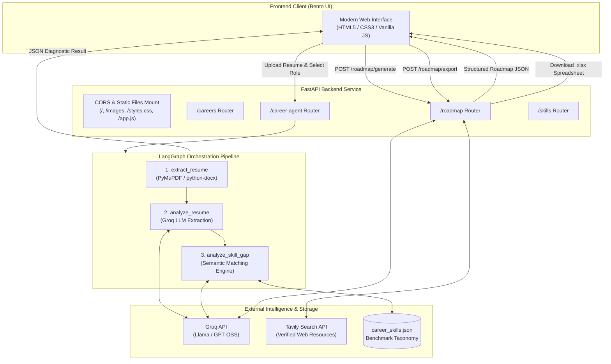

<div align="center">

  

  # 🌉 SkillBridge Career Agent

  **Agentic AI Career Intelligence, Semantic Skill Gap Analysis & Learning Roadmap Engine**

  [](https://python.org)
  [](https://fastapi.tiangolo.com)
  [](https://langchain-ai.github.io/langgraph/)
  [](https://groq.com)
  [](https://tavily.com)
  [](LICENSE)

  <p align="center">
    Empowering students and job-seekers to bridge the gap between their current resume skills and target tech roles through state-of-the-art semantic matching, automated curriculum planning, and live web research.
  </p>

</div>

---

## 📑 Table of Contents

- [Key Features](#-key-features)
- [System Architecture](#-system-architecture)
- [Tech Stack](#-tech-stack)
- [Directory Structure](#-directory-structure)
- [Getting Started](#-getting-started)
  - [Prerequisites](#prerequisites)
  - [1. Clone & Set Up Virtual Environment](#1-clone--set-up-virtual-environment)
  - [2. Configure Environment Variables](#2-configure-environment-variables)
  - [3. Start the Application](#3-start-the-application)
- [API Reference](#-api-reference)
- [Testing](#-testing)
- [License](#-license)

---

## ✨ Key Features

- **Multi-Format Resume Ingestion**: Fast, local text extraction from `.pdf` and `.docx` resumes using PyMuPDF and python-docx without saving sensitive files to disk.
- **LLM-Powered Profile Extraction**: Leverages Groq ultra-low latency inference to parse candidate identity, work experience, education, projects, and demonstrated technical proficiencies into structured Pydantic models.
- **Semantic Skill Gap Engine**: Replaces fragile keyword-matching with a 3-tier hybrid evaluation engine:
  - *Tier 1*: Direct normalized exact matching.
  - *Tier 2*: Canonical alias and acronym mapping (`K8s` ➔ `Kubernetes`, `JS` ➔ `JavaScript`, `Docker Containers` ➔ `Docker`).
  - *Tier 3*: LLM semantic equivalence (e.g., recognizes that `PostgreSQL` satisfies `SQL`, `AWS EC2/S3` satisfies `Cloud Computing`, or `FastAPI` satisfies `REST APIs`).
- **Personalized Learning Roadmap**: Formulates an actionable, week-by-week curriculum sequenced from foundational to advanced milestones, complete with estimated study hours, difficulty ratings, and hands-on capstone project prompts.
- **Live Web Research (Tavily)**: Dynamically verifies and fetches official documentation, top-rated tutorials, and free video courses for each missing skill.
- **Interactive Excel (.xlsx) Export**: Generates a downloadable, multi-tab styled Excel workbook complete with schedule timelines, study checklists, and clickable resource hyperlinks.
- **Modern Bento Grid Web Interface**: Handcrafted in vanilla HTML5, CSS3, and modern JavaScript—featuring obsidian dark mode, tactile glassmorphism, animated SVG progress rings, search filters, and real-time backend status indicators.

---

## 🏗️ System Architecture



---

## 🛠️ Tech Stack

| Domain | Technologies |
| :--- | :--- |
| **Backend API** | [FastAPI](https://fastapi.tiangolo.com), [Uvicorn](https://www.uvicorn.org), [Pydantic v2](https://docs.pydantic.dev) |
| **Agentic Workflow** | [LangGraph](https://langchain-ai.github.io/langgraph/), [LangChain Core](https://python.langchain.com) |
| **LLM Provider** | [Groq](https://groq.com) (`openai/gpt-oss-20b`, `llama-3.3-70b-versatile`) |
| **Web Search & Research** | [Tavily Search API](https://tavily.com) |
| **Document Processing** | [PyMuPDF](https://pymupdf.readthedocs.io), [python-docx](https://python-docx.readthedocs.io), [openpyxl](https://openpyxl.readthedocs.io) |
| **Frontend Application** | Semantic HTML5, Modern CSS3 (Bento Grid & Glassmorphism), Vanilla JavaScript (ES6+) |
| **Testing & Quality** | [Pytest](https://pytest.org), [HTTPX](https://www.python-httpx.org) |

---

## 📁 Directory Structure

```text
skillbridge_starter/
├── backend/
│   ├── core/
│   │   ├── config.py              # Environment configuration & constraints
│   ├── graphs/
│   │   ├── career_graph.py        # LangGraph StateGraph compilation
│   │   ├── nodes.py               # Workflow node handlers
│   │   └── state.py               # Shared CareerState TypedDict definition
│   ├── routes/
│   │   ├── career.py              # Career roles query endpoints
│   │   ├── career_agent.py        # End-to-end resume diagnosis endpoint
│   │   ├── resume.py              # Standalone resume analysis endpoint
│   │   ├── roadmap.py             # Roadmap generation & Excel export endpoints
│   │   └── skill_gap.py           # Standalone skill gap analysis endpoint
│   ├── schemas/
│   │   ├── career.py              # Career Pydantic schemas
│   │   ├── resume.py              # CareerProfile & extraction schemas
│   │   ├── roadmap.py             # Milestone, Resource & Roadmap schemas
│   │   └── skill_gap.py           # Skill gap request & response schemas
│   ├── services/
│   │   ├── career_service.py      # Skill taxonomy queries
│   │   ├── resume_service.py      # LLM profile extraction service
│   │   ├── roadmap_service.py     # Tavily search & curriculum planner
│   │   └── semantic_skill_gap_service.py # 3-tier semantic matching engine
│   ├── utils/
│   │   ├── excel_exporter.py      # In-memory openpyxl workbook generator
│   │   └── resume_parser.py       # PDF/DOCX stream text extraction
│   └── main.py                    # FastAPI entrypoint & static mounting
├── data/
│   └── career_skills.json         # Benchmark skill taxonomy across tech roles
├── frontend/
│   ├── images/
│   │   └── SkillBridge Student Growth Logo.png
│   ├── app.js                     # Client UI controller & API integration
│   ├── index.html                 # Bento Grid single-page layout
│   └── styles.css                 # Custom design system & glassmorphism
├── tests/
│   ├── test_api.py                # Health & API route test suite
│   └── test_resume_parser.py      # Document parsing unit tests
├── test_skill.py                  # Standalone semantic skill gap tests
├── requirements.txt               # Pinned project dependencies
└── README.md                      # Project documentation
```

---

## 🚀 Getting Started

### Prerequisites

- **Python 3.10+** installed on your system.
- A **[Groq API Key](https://console.groq.com)** (free tier available).
- A **[Tavily API Key](https://tavily.com)** for live web search and learning resource curation.

---

### 1. Clone & Set Up Virtual Environment

```bash
# Clone the repository
git clone https://github.com/your-username/skillbridge.git
cd skillbridge

# Create virtual environment
python -m venv .venv

# Activate virtual environment
# Windows (PowerShell):
.\.venv\Scripts\Activate.ps1
# macOS / Linux:
source .venv/bin/activate

# Upgrade pip and install dependencies
pip install --upgrade pip
pip install -r requirements.txt
```

---

### 2. Configure Environment Variables

Create a `.env` file in the project root:

```env
# Groq API Configuration
GROQ_API_KEY=your_groq_api_key_here
GROQ_MODEL=openai/gpt-oss-20b

# Tavily Search API Configuration
TAVILY_API_KEY=your_tavily_api_key_here

# Backend Service Base URL
API_BASE_URL=http://127.0.0.1:8000
```

---

### 3. Start the Application

Run the FastAPI server:

```bash
uvicorn backend.main:app --reload --port 8000
```

Once started:
- 🌐 **Web Application**: Open [http://localhost:8000](http://localhost:8000)
- 📚 **Interactive Swagger API Docs**: Open [http://localhost:8000/docs](http://localhost:8000/docs)
- 🩺 **Health Check**: Open [http://localhost:8000/health](http://localhost:8000/health)

---

## 📡 API Reference

| Method | Endpoint | Description |
| :--- | :--- | :--- |
| `GET` | `/health` | Service health status check |
| `GET` | `/careers` | Returns list of configured career paths |
| `GET` | `/careers/{name}/skills` | Returns required benchmark skills for a role |
| `POST` | `/career-agent/analyze` | Full LangGraph agent execution: extracts text, parses profile, and executes semantic skill gap analysis |
| `POST` | `/skills/analyze` | Standalone semantic skill gap diagnostic |
| `POST` | `/roadmap/generate` | Generates a sequenced, week-by-week curriculum with Tavily resources |
| `POST` | `/roadmap/export` | Generates and streams a formatted `.xlsx` workbook |

---

## 🧪 Testing

Execute the automated test suite with `pytest`:

```bash
# Run all tests
pytest

# Run tests with verbose output
pytest -v
```

All tests cover:
- Health check and API route availability.
- Multi-format document text extraction (PDF & DOCX).
- Semantic skill gap matching (exact, alias, and LLM-evaluated equivalence).

---

## 📄 License

Distributed under the MIT License. See `LICENSE` for more information.
